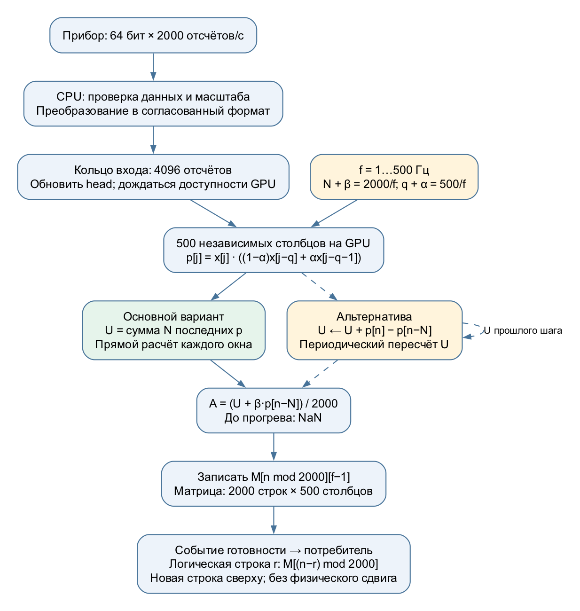

# Потоковая АКФ на RK3588 / Mali-G610

Расчётно-пояснительное решение тестового задания · 15 ноября 2026 г.

## 1. Результат и границы оценки

Предлагается считать 500 значений оконной АКФ при каждом новом входном
отсчёте, то есть 2000 строк/с, и хранить последние 2000 строк в кольцевой
матрице. По горизонтали расположены частоты 1…500 Гц; по вертикали - время,
новая строка сверху. Матрица хранит одну секунду выходных данных.

Для первой реализации на GPU рекомендовано прямое суммирование: его
нагрузка мала, схема проста и ошибка не накапливается между строками.
Рекуррентное обновление приведено как альтернативная оптимизация.

| Параметр | Оценка |
| --- | --- |
| Прямой расчёт | 140,52 млн арифметических операций/с = 0,00014052 TOPS |
| Рекуррентный расчёт | 13 млн операций/с = 0,000013 TOPS, без периодического пересчёта |
| Плановый запас прямого расчёта ×10 | 1,4052 GOPS = 0,0014052 TOPS |
| Основные буферы FP32 | 4 049 152 байта, около 3,862 МиБ |
| Практический бюджет данных FP32 | 8 МиБ, включая второй снимок матрицы |
| GPU | один Mali-G610 MC4 в RK3588; 500 логических задач, не 500 физических ядер |
| CPU | один обслуживающий поток; выделенное CPU-ядро по арифметике не требуется |
| Разработка до передачи на тестирование | 13–18 рабочих дней одного разработчика при готовой плате и согласованной точности |

Оценки операций относятся к вещественной арифметике выбранной дискретной
модели. Для FP32 это также 0,14052 GFLOP/s в прямом варианте. Это не оценка
INT8 TOPS и не доказательство сохранения всех 64 бит входа. Точное вычисление
для полного 64-битного целого диапазона требует отдельной многословной
арифметики; её машинную стоимость нельзя приравнивать к FP32.

Полноценный запуск на RK3588 здесь не заявляется: предоставлены математика,
проверяемый CPU-прототип и эскиз OpenCL-ядра. Платы, драйвера и интерфейса
прибора в исходных данных нет.

## 2. Интерпретация условия

1. Частота дискретизации Fs = 2000 Гц, шаг времени Δt = 0,0005 с.
2. Для столбца f: T_f = 1/f, задержка τ_f = T_f/4. Обозначение t в описании
   задержки считаю опечаткой: t - переменная интегрирования, τ - задержка.
3. Строка формируется на каждом отсчёте. Частота выхода в условии отдельно
   не задана; 2000 строк/с - явно принятое допущение, наиболее требовательный
   естественный вариант без дополнительного повышения частоты выхода.
4. S(t) трактуется как непрерывный входной поток, наблюдаемый в скользящем
   окне. Для S(t−τ) используется предыстория, а не циклический сдвиг окна
   и не обнуление сигнала за границами выделенной группы.
5. Интеграл не нормируется на T и не центрируется: вычитание среднего,
   нормирование к единице и деление на энергию условием не заданы.
6. Величины до достаточного накопления истории обозначаются NaN; потребителю
   также передаётся номер отсчёта. Это не готовые нулевые значения АКФ.
7. Основной вычислительный профиль использует масштабированный сигнал
   |x| ≤ 1. Переход к FP32 допустим только после согласования погрешности.

У исходного условия нет единственной дискретной реализации. Если под S(t)
подразумевается только конечная группа, нулевая за её пределами, интеграл
будет считаться лишь по пересечению групп, примерно 3T/4. Это другой
алгоритм с другим прогревом. Если требуются отдельные частотные полосы,
нужен банк фильтров и спецификация полос/подавления; данная формула этого
не задаёт. В настоящем решении f определяет окно и задержку, а не фильтр.

Даже для чистой синусоиды частоты f интеграл по полному периоду с задержкой
T/4 равен нулю. Поэтому эти значения нельзя называть спектром мощности
или использовать как спектральную амплитуду без дополнительного обоснования.

## 3. Причинная дискретная модель

В момент t_n = n/Fs вычисляется интеграл по прошлому интервалу длиной T_f:

```text
A_f[n] ≈ ∫ от t_n−T_f до t_n  x(u) · x(u−τ_f) du
```

Это перенос окна исходного интеграла [−T/2; T/2] к текущему времени.
Центр окна равен t_n−T_f/2. Таким образом, строка имеет общий момент
готовности t_n, но центры окон столбцов различаются. Если нужен общий
центральный момент всех окон, потребуется дополнительная задержка
до 0,5 с и другая временная привязка выходной строки.

Длины окон и задержки обычно нецелые:

```text
L_f = 2000/f = N_f + β_f,    N_f = floor(2000/f)
d_f = 500/f  = q_f + α_f,    q_f = floor(500/f)
0 ≤ α_f, β_f < 1
```

Дробная задержка реализуется линейной интерполяцией, а дробная длина
окна - весом крайнего отсчёта. Применяется правая прямоугольная квадратура:

```text
p_f[j] = x[j] · ((1−α_f)·x[j−q_f] + α_f·x[j−q_f−1])

A_f[n] = Δt · ( Σ p_f[n−k] + β_f·p_f[n−N_f] )
                   k=0…N_f−1
```

При нулевом коэффициенте соответствующее слагаемое математически
не требуется. При постоянном сигнале x = C получается A_f = C²/f,
что согласуется с ненормированным интегралом. Единицы результата:
квадрат единиц сигнала, умноженный на секунду.

Линейная интерполяция является допущением о восстановлении сигнала, а не
точным восстановлением произвольного аналогового сигнала. При 500 Гц
на период приходится только четыре отсчёта. Например, задержка на половину
отсчёта для компоненты 500 Гц даёт амплитудный множитель cos(π/4) ≈ 0,707.
Если такая погрешность недопустима, потребуется более точный фильтр дробной
задержки или иная модель квадратуры, с пересчётом ресурсов и срока.

Округлять L_f и d_f до целых для всех столбцов нельзя без явного изменения
задачи: например, при округлении вниз для f = 401…500 получается L = 4,
а при округлении задержки вниз d = 1. Все сто столбцов стали бы одинаковыми.
Предложенная схема сохраняет разные параметры всех 500 столбцов, хотя
это не означает независимое спектральное разрешение 1 Гц.

| f, Гц | L, отсчётов | d, отсчётов | T, мс |
| --- | --- | --- | --- |
| 1 | 2000 | 500 | 1000 |
| 3 | 666 + 2/3 | 166 + 2/3 | 333,333 |
| 100 | 20 | 5 | 10 |
| 499 | 4 + 4/499 | 1 + 1/499 | 2,004 |
| 500 | 4 | 1 | 2 |

## 4. Граф вычислений и буферы

Граф приведён также в векторном файле docs/graph.svg. Внутри каждого
столбца операция p - узел интерполяции и умножения; узел суммы сворачивает
N произведений и одно взвешенное крайнее произведение. Между частотами
нет зависимостей, редукции между столбцами и атомарные операции не нужны.

Для рекуррентного варианта вводится состояние U_f:

```text
U_f[n] = Σ p_f[n−k], k=0…N_f−1
U_f[n] = U_f[n−1] + p_f[n] − p_f[n−N_f]
A_f[n] = Δt · (U_f[n] + β_f·p_f[n−N_f])
```

Старое произведение используется дважды: для удаления из суммы и для
дробного хвоста. Начальное состояние U = 0; отсутствующие исторические
отсчёты для внутреннего состояния равны нулю. Результат публикуется
только после прогрева. Рекуррентный расчёт математически эквивалентен
прямому; в конечной точности возможен дрейф. Пересчёт U из истории
каждые 2048 входных отсчётов ограничивает время накопления ошибки.

История должна покрывать T_max + τ_max = 1,25 с. Для основной суммы при
f = 1 нужны 2500 реальных отсчётов; для универсального обновления с
вычитанием и без устранения нулевых коэффициентов достаточно 2502 ячеек.
Выбирается кольцо 4096: запас и простая адресация битовой маской.

Полная первая строка доступна после 2500 отсчётов: индекс n = 2499,
время 1,2495 с от первого отсчёта или около 1,25 с от начала накопления.
Столбец f = 500 готов уже при n = 4. До этого соответствующие ячейки NaN.
Все 2000 строк матрицы полностью валидны при n = 4498, примерно через
2,25 с. Накопление истории не равно вычислительной задержке.

Матрица хранится как M[2000][500], то есть 500 столбцов и 2000 строк.
На входном отсчёте n записывается физическая строка n mod 2000.
Логическая строка r, где r = 0 - самая новая:

```text
M_view[r, f−1] = M[(n−r) mod 2000, f−1]
```

При появлении новой строки предыдущие логически сдвигаются вниз;
старейшая перезаписывается. Копирование всей матрицы не требуется.
Снимок для потребителя фиксирует номер строки и защищается от перезаписи
событием завершения или вторым буфером. Одного указателя без синхронизации
недостаточно, если чтение и запись выполняются одновременно.



## 5. Вычислительная производительность

Считаем сложение, вычитание и умножение за одну арифметическую операцию;
FMA - за две. Деления при подготовке коэффициентов, индексная арифметика,
проверки границ, обращения к памяти и запуск ядра не включены в TOPS.
Оценка не является числом GPU-инструкций или замером времени.

Для p при заранее заданных α и 1−α: два умножения для интерполяции,
одно сложение и одно умножение на x, всего четыре операции.

```text
Σ floor(2000/f), f=1…500 = 13 352
```

В прямом варианте на один столбец требуется 5N + 7 операций: N произведений
по четыре операции, N накоплений, четыре операции хвостового произведения,
умножение хвоста на β, сложение и умножение на Δt. Это единообразная верхняя
оценка без удаления слагаемых с нулевыми коэффициентами.

```text
C_row = 5·13 352 + 7·500 = 70 260 операций/строку
P_direct = 70 260·2000 = 140 520 000 операций/с
         = 0,14052 GOPS = 0,00014052 TOPS
```

Рекуррентный вариант: два произведения по четыре операции, два действия
для U, два для дробного хвоста и одно масштабирование - 13 операций/ячейку.

```text
P_recursive = 13·500·2000 = 13 000 000 операций/с
            = 0,013 GOPS = 0,000013 TOPS
```

Пересчёт всех сумм каждые 2048 отсчётов добавляет в среднем не более
5·13 352·2000/2048 ≈ 65 195 операций/с, но создаёт нагрузку в отдельной
строке. Средняя оценка не гарантирует срок выполнения этой строки.

При резерве ×10 прямой расчёт требует 1,4052 GOPS (0,0014052 TOPS).
Это инженерный запас, а не измеренный коэффициент полезной загрузки.
На каждый отсчёт имеется 0,5 мс, из которых часть уйдёт на драйвер,
передачу данных и синхронизацию. Если на сам расчёт выделено 0,25 мс,
достаточная эффективная скорость составляет 70 260 / 0,00025 = 281,04 MOPS.

Для оценки числа физических ядер нужно знать измеренную полезную скорость
одного ядра P_core на выбранной арифметике и время на прочие этапы:
K ≥ ceil(C_row / (P_core·t_compute)). Только по числу столбцов определить
K нельзя. По объёму арифметики ожидается достаточность одного shader core,
но это предварительная оценка; практический запуск использует штатный
GPU MC4, а распределение по его четырём ядрам делает драйвер.

## 6. Память и обмен данными

| Буфер | Количество × размер | Байты |
| --- | --- | --- |
| Входное кольцо исходных данных | 4096 × 8 | 32 768 |
| Кольцо масштабированного FP32 | 4096 × 4 | 16 384 |
| Матрица FP32 | 2000 × 500 × 4 | 4 000 000 |
| Итого, основной прямой вариант | | 4 049 152 |
| Дополнительное состояние U для рекурсии | 500 × 4 | 2 000 |
| Таблица N, q, α, β, 1−α, если хранить отдельно | 500 × 20 | 10 000 |
| Дополнительный согласованный снимок матрицы | 2000 × 500 × 4 | 4 000 000 |

Даже со снимком, таблицей и состоянием получается 8 061 152 байта,
что укладывается в 8 МиБ (8 388 608 байт). Это бюджет данных алгоритма,
без ОС, графического стека, выделений драйвера и интерфейса отображения.
Объём общей памяти платы нельзя выбирать только по этой таблице.

Для FP64 аналогичный прямой вариант использует 32 768 + 32 768 +
8 000 000 = 8 065 536 байт. С дополнительным снимком, состоянием и
таблицами можно ориентироваться на 16 МиБ данных. Python-прототип
использует FP64-массивы, но также имеет служебные объекты интерпретатора;
его RSS не равен GPU-бюджету.

Входной поток: 2000·8 = 16 000 байт/с. Запись новых FP32-строк:
2000·500·4 = 4 000 000 байт/с. Прямой вариант без учёта кэша читает до
3·(13 352+500)·4·2000 = 332 448 000 байт/с (~332 МБ/с).
Суммарно с записью результата - около 336,45 МБ/с. Реальный трафик DRAM
может быть существенно меньше благодаря повторным обращениям к кольцу
размером 16 КиБ; прогноз кэширования не заменяет профилирование.

В рекуррентном варианте два произведения читают шесть FP32-значений,
состояние U читается и записывается, результат записывается: до 36 байт
на ячейку или около 36 МБ/с без учёта кэша и периодического пересчёта.

Физический сдвиг 1999 строк матрицы на каждом отсчёте стоил бы около
32 ГБ/с суммарного чтения и записи FP32. Кольцо устраняет этот расход.
Если потребитель требует новый цельный снимок всей матрицы 2000 раз/с,
останется отдельная нагрузка порядка 8 ГБ/с только на выдачу снимков.
Поэтому интерфейс должен отдавать новые строки или редкие снимки.

## 7. 64-битный вход и численная точность

Фраза «диапазон значений 64 бит» не определяет тип данных и допустимую
ошибку. Нужно различать int64, uint64 и IEEE-754 binary64.

FP32 хранит 24 значащих двоичных разряда, FP64 - 53. Поэтому даже FP64
не сохраняет произвольное 64-битное целое в точности. Простое приведение
всего диапазона к float без обсуждения точности не удовлетворяет условию.

Практический профиль: CPU принимает исходное 64-битное значение, применяет
согласованный постоянный масштаб x = S/C, обеспечивающий |x| ≤ 1, и лишь
затем преобразует результат в FP32 для GPU. Тогда A_S = C²·A_x; C и единицы
передаются вместе с матрицей. Обратное масштабирование лучше выполнять
на CPU в FP64 либо оставлять результат нормированным, чтобы не переполнить
FP32. Вычитание смещения/среднего меняет АКФ и здесь не применяется.

Для binary64 масштаб выбирают по реальному диапазону прибора; он не обязан
вмещать любой возможный finite binary64. NaN, Inf, пропуски отсчётов и
выход за согласованный диапазон должны обнаруживаться до GPU. После
разрыва временной сетки безопасный вариант - сбросить историю, заново
прогреть окно и выставить признак разрыва. Интерполяция пропущенных пакетов
не должна выполняться незаметно для потребителя.

Прямое FP32-суммирование до 2000 членов имеет параметр ошибки накопления
γ_2000 ≈ 1,19·10⁻⁴ при u = 2⁻²⁴, ещё до учёта преобразования входа и
интерполяции. Относительная ошибка АКФ возле нуля может быть большой;
сравнивать нужно абсолютную и относительную ошибки совместно. Парное или
компенсированное суммирование уменьшает ошибку, но меняет оценку операций.
Дробная задержка и квадратура дают отдельную ошибку модели, которую
улучшением разрядности не устранить.

Если обязательна точность всех входных целых битов, один 64-битный
аккумулятор недостаточен. Произведение uint64 требует до 128 бит, сумма
2000 произведений - до 139 бит без знака; для int64 достаточно до 138 бит
со знаком. Это оценка целых произведений до дробных весов. Веса α и β
вносят рациональные знаменатели и требуют отдельного формата; нельзя
просто объявить один 128-битный аккумулятор точным решением всей задачи.
Варианты: многословная целочисленная/фиксированная арифметика на GPU,
согласованная потеря младших битов либо изменение требований к платформе.
Такой вариант отдельно оценивается по машинным операциям и срокам.

OpenCL не гарантирует FP64 только фактом наличия OpenCL. Перед выбором
профиля нужно запросить CL_DEVICE_DOUBLE_FP_CONFIG и расширение
cl_khr_fp64 / соответствующую возможность языка. Для Mali-G610 аппаратную
FP64 в данной оценке не предполагаю. Источники [2–3] описывают механизм
проверки; они не являются подтверждением поддержки конкретного драйвера.

## 8. Размещение на Mali и работа в реальном времени

По официальному описанию Rockchip, RK3588 содержит Mali-G610 MC4 с четырьмя
shader cores [1]. Указанные там 6 TOPS INT8 относятся к NPU, а не к GPU;
использовать их для обоснования данной АКФ нельзя. Заявленная поддержка
API у SoC также не подтверждает наличие нужного OpenCL runtime в образе ОС.

Предлагается OpenCL C с ядром, совместимым по синтаксису с OpenCL 1.2.
Каждый work-item вычисляет один частотный столбец. Запускается 512
work-items, из которых последние 12 сразу завершаются. Стартовый размер
work-group - 64, то есть восемь групп; он проверяется относительно лимитов
устройства. Число work-items не равно числу физических вычислительных ядер.

Прямые окна имеют неодинаковую длину, от 2000 до 4; это создаёт дисбаланс
и не позволяет ожидать идеальной загрузки SIMD. При выявленном узком месте
длинные окна можно распределить на группу с редукцией либо перейти на
рекуррентный вариант. В первой версии это усложнение не требуется без замера.

CPU принимает данные, проверяет последовательность/время/диапазон,
масштабирует, обновляет кольцо и ставит вычисление в очередь. Ядро пишет
одну строку в матрицу GPU. Потребитель использует номер последней готовой
строки. Память выделяется заранее; нет выделений, компиляции и создания
контекста на пути обработки каждого отсчёта. Совместная физическая память
CPU/GPU не отменяет правил map/unmap, событий и согласованности OpenCL.

В базовом варианте один kernel launch на отсчёт даёт 2000 запусков/с.
При такой небольшой работе накладные расходы могут преобладать. Нужно
измерить цепочку «получение → запись → запуск → готовность», отдельно
от чистого времени GPU. Если разрешена задержка, пакет из B = 16 отсчётов
снижает частоту запусков до 125/с, но первый отсчёт ждёт ещё 7,5 мс.
При этом вычисляются все 16 строк, частота выходных данных остаётся 2 кГц.
При требовании готовности каждой строки за 0,5 мс такая пакетизация
неприемлема. Приведённое ядро acf.cl реализует только B = 1.

Обычная ОС и общий графический ускоритель не дают автоматической гарантии
жёсткого real-time. На целевой плате надо измерить максимальную задержку,
джиттер, рост очереди, потери данных и влияние температуры/других нагрузок.
Если дедлайн строгий и драйвер его не выдерживает, вариант CPU/NEON следует
рассматривать как альтернативу, но он уже не выполняет требование считать
именно на GPU. Арифметическая достаточность и гарантия дедлайна - разные
результаты проверки.

## 9. Оценка разработки до передачи на тестирование

Оценка дана для одного разработчика, знакомого с C/C++ и OpenCL,
при наличии рабочей RK3588-платы, драйвера и описанного интерфейса прибора.
Один день - примерно восемь рабочих часов. Внешнее приёмочное тестирование
и ожидание оборудования в оценку не входят; собственные проверки входят.

| Этап | Рабочие дни |
| --- | --- |
| Уточнить трактовку формулы, тип входа, ошибку, задержку и интерфейс | 1–2 |
| Эталон, генераторы сигналов, проверки дискретизации и расчёты | 2 |
| CPU-приём, временные метки, кольца, формат результата | 2 |
| OpenCL-ядро, управление буферами и событиями | 2–3 |
| Сверка с эталоном, пропуски/перезапуск, длительный прогон | 2–3 |
| Профилирование, точность, оптимизация при необходимости | 1–2 |
| Сборка, инструкция, отчёт и передача на тестирование | 1 |
| Подытог | 11–15 |
| Резерв на интеграцию | 2–3 |
| Итого | 13–18 |

Это примерно 3–4 календарные рабочие недели. Если потребуется точная
многословная арифметика полного 64-битного диапазона, ориентировочная
добавка - 5–10 рабочих дней после выбора формата и критериев точности.
Отсутствие подходящего драйвера, недоступность платы или разработка
интерфейса прибора с нуля требуют отдельной оценки, а не скрытого включения
в резерв. Непрерывный 24-часовой прогон можно вести параллельно документации.

## 10. Проверка и критерии передачи

В приложении reference.py реализованы независимое прямое суммирование
и потоковое рекуррентное обновление с ограниченными кольцевыми буферами.
Эталон использует math.fsum; потоковый вариант периодически пересчитывает
состояние. Шесть автоматических тестов проверяют:

- постоянный сигнал: A_f = C²/f, включая C = 0 и C = −1;
- одиночный импульс: нулевое произведение при положительных задержках;
- случайный сигнал: все 500 столбцов в выбранных контрольных строках;
- синусоиду и переход к постоянному уровню;
- дробные окна/задержки, первую валидную строку, повторный оборот обоих колец,
  границу периодического пересчёта и порядок строк;
- некорректный вход и воспроизводимость расчётов операций.

В проверках эквивалентности задан абсолютный допуск 2·10⁻¹⁴ для
нормированного CPU binary64-прототипа. Это технический допуск теста,
не предложенный заказчику допуск FP32 и не доказательство точности
относительно неизвестного аналогового сигнала.

Файл acf.cl содержит эскиз прямого OpenCL-ядра.
Дополнительно тот же исходник ядра выполнен как скалярный C-код на CPU:
16 500 сравнений FP32 с эталоном на постоянном, случайном и синусоидальном
сигналах со скачком, в том числе с NaN в недоступной истории. Максимальная
абсолютная ошибка на этой выборке - 2,3133·10⁻⁶. Проверочный абсолютный
порог 2·10⁻⁴/f + 10⁻⁷ выбран с запасом относительно ошибки накопления;
он не является согласованным требованием к прибору. Проверка синтаксиса
и скалярной арифметики не равна проверке исполнения на GPU. Host-код работы
с прибором и OpenCL, сборка на RK3588 и аппаратный замер в приложении
отсутствуют сознательно: задание требует граф и оценки, а не готовый драйвер.

Перед передачей промышленной реализации нужны: сравнение GPU с эталоном
по согласованному абсолютному/относительному допуску, тесты реального
64-битного формата и экстремальных значений, контроль пропусков и порядка,
профиль памяти, длительный прогон и измерение задержки на целевом образе ОС.
Отдельно фиксируются версия платы/драйвера, частоты, температура и фоновая
нагрузка. Только этот этап позволит подтвердить дедлайн 0,5 мс.

## 11. Источники

[1] Rockchip, RK3588 Brief Datasheet: состав GPU (Mali-G610 MC4, четыре
shader cores), разделение GPU и NPU, заявленные API. Проверено 15.11.2026.
https://www.rock-chips.com/uploads/pdf/2022.8.26/191/Rockchip%20RK3588%20Brief%20Datasheet%20V1.0_20250828.pdf

[2] Khronos, clGetDeviceInfo: запросы возможностей устройства, включая
CL_DEVICE_DOUBLE_FP_CONFIG и лимиты выполнения.
https://registry.khronos.org/OpenCL/specs/unified/refpages/man/html/clGetDeviceInfo.html

[3] Khronos, cl_khr_fp64: поддержка double как опциональной возможности.
https://registry.khronos.org/OpenCL/specs/unified/refpages/man/html/cl_khr_fp64.html

Все значения нагрузки, памяти, прогрева и сроков в решении - собственные
расчёты и инженерные оценки, а не результаты аппаратного бенчмарка.
